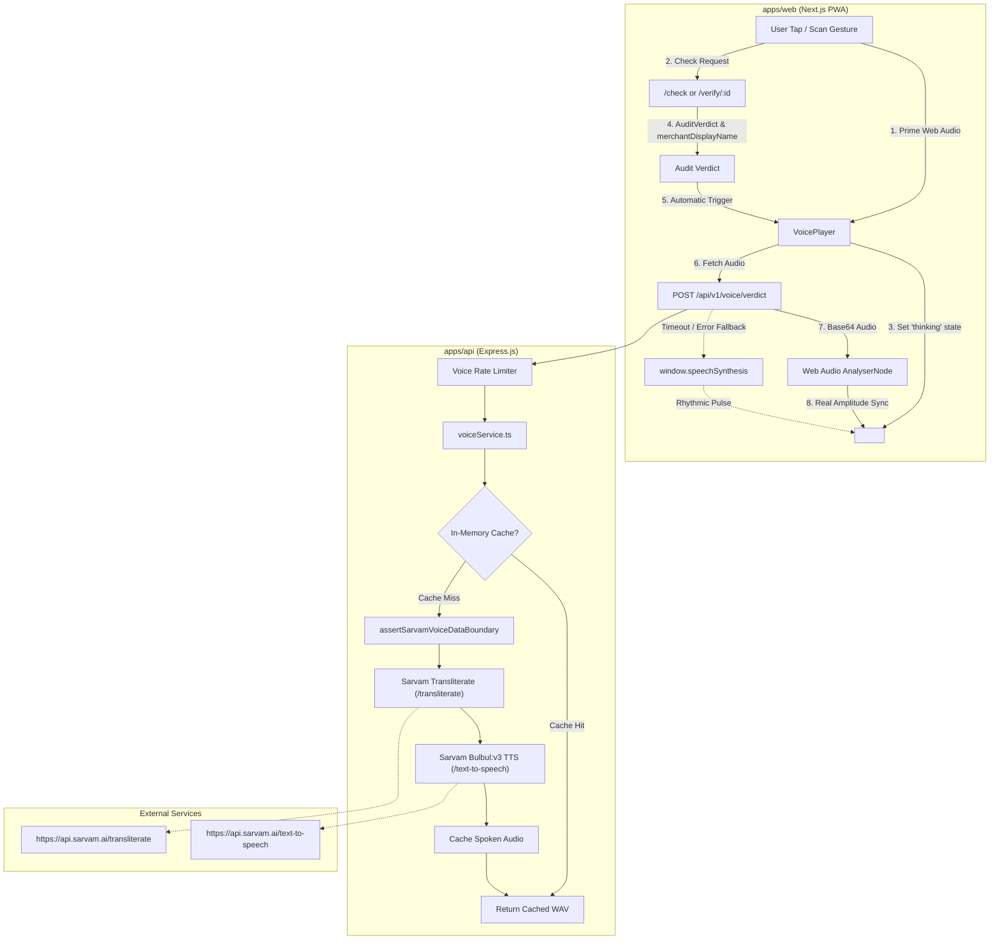

# VOICE.md — QRaksha Multilingual Voice Assistant

QRaksha includes a multilingual voice assistant supporting **Hindi (`hi-IN`)**, **English (`en-IN`)**, and **Kannada (`kn-IN`)**. Just before a customer pays, it audibly confirms which merchant they are about to pay and whether that merchant's physical UPI QR sticker is verified.

---

## 1. Architecture Overview



### Core Architecture Principles

1. **Server-Side Exclusivity:** Sarvam API calls happen **only** on the backend (`apps/api`). The `SARVAM_API_KEY` is never transmitted to or bundled within the browser.
2. **AI Data Boundary Enforcement:** All payloads to Sarvam pass through `assertSarvamVoiceDataBoundary()`. Allowed fields: template text, language code, verified merchant display name, and TTS voice settings. **Forbidden:** GST/Udyam numbers, bank VPAs, KYC addresses, phones, GPS coordinates, photo bytes/embeddings, and audit internals.
3. **Registry-Derived Names Only:** Merchant display names are **only** retrieved from the trusted database registry (`public.merchant`). The system **never** speaks names extracted from scanned QR payloads, neutralizing attacker audio injection.
4. **Zero-Latency In-Memory Caching:**
   - 12 static no-name phrases (4 verdicts × 3 languages) are cached in-memory.
   - Transliterated merchant names are cached per `(cleanName, targetLang)`.
   - Dynamic synthesized sentences are cached per `(verdict, lang, merchantName)`.
5. **Autoplay Compliance:** Web Audio contexts are initialized/resumed on the user's initial scan or check gesture, ensuring seamless automatic playback when the verdict renders without browser autoplay blockage.
6. **Graceful Fail-Safe:** If Sarvam is unavailable or times out (> 2 seconds), playback falls back immediately to the browser's native `window.speechSynthesis` in the matching Indic language (`hi-IN`, `kn-IN`, `en-IN`). If speech synthesis is blocked, the interface degrades silently to on-screen text without delaying or altering the verdict.

---

## 2. Voice Button: Thinking Orb States

The voice button is an interactive **Thinking Orb** (`<VoiceOrb />`) built with the hand-tuned dot-sphere engine from `thinking-orbs`.

| State          | Orb Visual & Animation                                     | Trigger & Behavior                                                                                                                                                                   | Accessibility Text                    |
| :------------- | :--------------------------------------------------------- | :----------------------------------------------------------------------------------------------------------------------------------------------------------------------------------- | :------------------------------------ |
| **`idle`**     | Soft slow breathing glow (`breathing` mode).               | Waiting for user interaction or verdict. Tap to play or replay.                                                                                                                      | `"Tap to replay"` / `"Tap to listen"` |
| **`thinking`** | Swirling, shifting gradient (`working` mode).              | Activated the moment the scan/check begins so audio is requested in parallel with verdict calculation.                                                                               | `"Preparing audio…"`                  |
| **`speaking`** | Amplitude-driven rhythmic pulse (`listening` mode).        | For Sarvam audio, real-time waveform amplitude is extracted via a Web Audio `AnalyserNode`. For `speechSynthesis` fallback, a steady rhythmic sine oscillation is used. Tap to stop. | `"Speaking (tap to stop)"`            |
| **`error`**    | Static, dimmed (60% opacity) with retry exclamation badge. | Triggered if synthesis and speech fallback fail. Verdict card text remains fully visible. Tap to retry.                                                                              | `"Audio unavailable (tap to retry)"`  |

### Semantic Verdict Color Tokens

Color strictly adheres to `DESIGN.md` Section 2:

- **`VERIFIED`**: `--ok` (`#2FBF71`), calm confidence.
- **`RECENTLY_REGISTERED` / `UNVERIFIED`**: `--warn` (`#F2B531`), cautionary amber.
- **`WARNING`**: `--danger` (`#E5384F`), faster pulse multiplier (1.6x–2.0x) + tactile haptic buzz (`navigator.vibrate([100, 50, 100])`).

### Accessibility & Reduced Motion

- A real semantic `<button>` with dynamic `aria-label` (`"Play verdict in {language}"` / `"Stop playing verdict in {language}"`) and `aria-pressed`.
- When `prefers-reduced-motion` is detected: particle animation speed is paused (`speed={0}`), dynamic amplitude scaling is disabled, and clear live-region text status is rendered.
- **State is never conveyed by color alone.** Every state displays explicit accompanying text status and screen-reader announcements via an `aria-live` region.

---

## 3. How to Add a New Language

Adding a new language (e.g. Tamil `ta-IN` or Telugu `te-IN`) requires four steps:

### Step 1: Update Language Codes & Messages (`packages/shared/src/voice/messages.ts`)

1. Extend `VoiceLanguageCode`:
   ```typescript
   export type VoiceLanguageCode = "en-IN" | "hi-IN" | "kn-IN" | "ta-IN";
   ```
2. Add language metadata to `SUPPORTED_VOICE_LANGUAGES`:
   ```typescript
   "ta-IN": {
     code: "ta-IN",
     label: "Tamil",
     nativeLabel: "தமிழ்",
   }
   ```
3. Add the 4 verdict templates to `VOICE_TEMPLATES`:
   ```typescript
   "ta-IN": {
     // needs native-speaker review
     VERIFIED: "நீங்கள் {merchant} அவர்களுக்கு பணம் செலுத்த உள்ளீர்கள்...",
     VERIFIED_NO_NAME: "...",
     RECENTLY_REGISTERED: "...",
     RECENTLY_REGISTERED_NO_NAME: "...",
     UNVERIFIED: "...",
     WARNING: "...",
   }
   ```
4. Add localized labels to `VERDICT_DISPLAY_LABELS` so on-screen text matches spoken audio.

### Step 2: Update Zod Schema (`packages/shared/src/schemas/voice.ts`)

Add the new code to `VoiceVerdictInputSchema`:

```typescript
lang: z.enum(["en-IN", "hi-IN", "kn-IN", "ta-IN"] as const);
```

### Step 3: Add to Language Selector (`apps/web/src/components/language-selector.tsx`)

Include the new code in `languages`:

```typescript
const languages: VoiceLanguageCode[] = ["en-IN", "hi-IN", "kn-IN", "ta-IN"];
```

### Step 4: Rebuild Shared & Run Tests

```bash
npm run build --workspace=packages/shared
npm run test:workspaces
```

---

## 4. Sarvam MCP Confirmation Matrix

The following details were verified directly against the live **Sarvam MCP server** (`C:\Users\harsh_aaghwa2\.gemini\antigravity-ide\mcp\sarvam\`):

### Confirmed from MCP & Schemas

| Feature                       | Details Confirmed via MCP                                                                                                                                                                                |
| :---------------------------- | :------------------------------------------------------------------------------------------------------------------------------------------------------------------------------------------------------- |
| **TTS Tool & Path**           | `sarvam_tools_tts_speak` / `POST https://api.sarvam.ai/text-to-speech`                                                                                                                                   |
| **Supported Languages**       | Confirmed 11 Indic languages via `sarvam_code_languages('tts')`: `en-IN`, `hi-IN`, `bn-IN`, `ta-IN`, `te-IN`, `gu-IN`, `kn-IN`, `ml-IN`, `mr-IN`, `pa-IN`, `od-IN`.                                      |
| **Default Speaker IDs**       | Confirmed 37 `bulbul:v3` voices via `sarvam_code_speakers`: default `shubh`, `priya` (warm friendly female), `aditya` (professional male), `neha`, `kabir`, `ritu`, `vijay`, `anand`, `tanya`, `suhani`. |
| **Transliteration API**       | Confirmed `sarvam_tools_transliterate` / `POST https://api.sarvam.ai/transliterate` supporting `en-IN` to native scripts.                                                                                |
| **Request & Response Format** | Header `api-subscription-key`, body `{ text, target_language_code, speaker, model, speech_sample_rate: 24000 }`, returns `{ audios: [ "<base64-wav>" ], request_id }`.                                   |
| **Pricing Model**             | Confirmed via `sarvam_code_pricing('bulbul:v3')`: billed per character, new accounts include ₹1,000 free trial credits.                                                                                  |

### Items Unconfirmed or Plan-Dependent

1. **Tier Rate Limits:** The Sarvam API docs state that requests-per-minute (RPM) limits depend on the specific account subscription tier (Free vs. Pro vs. Enterprise) and are not returned in MCP schemas. A server-side rate limiter of 5 requests per 10 seconds per client was added to protect quota.
2. **End-to-End Network Latency:** MCP tools run runtime API requests when configured with an active key, but network latency to `api.sarvam.ai` fluctuates between 300ms–1800ms depending on region and model (`bulbul:v3` vs `bulbul:v4-flash`). A 2,000ms abort timeout was implemented with an automatic fallback to browser `window.speechSynthesis`.
3. **HTTP Audio Streaming:** `bulbul:v4-flash` supports HTTP chunked streaming (`POST /text-to-speech/stream`) and WebSocket streaming (`/text-to-speech/ws`). In this MVP, full base64 WAV buffers were chosen for seamless Web Audio `AnalyserNode` amplitude calculation and in-memory caching.
