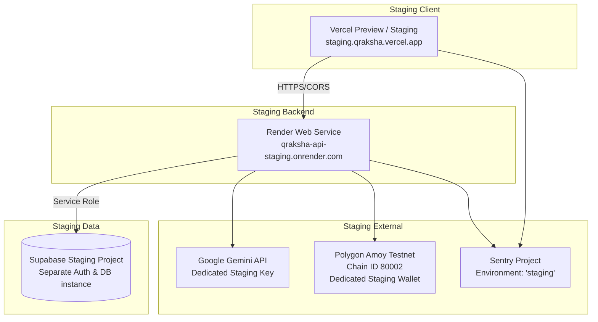

# Staging Deployment & Environment Topology Guide

This runbook documents the deployment, configuration, and verification procedure for the **QRaksha Staging Environment**, implementing all requirements specified in **`ARCHITECTURE.md` Section 13**.

---

## 1. Staging Topology & Isolation

The staging environment mirrors production while maintaining strict isolation across all four operational tiers:



### Strict Isolation Rules

1. **Database:** Staging uses its own dedicated Supabase project reference. Under no circumstance does staging point to production data.
2. **Custodial Wallet:** Staging uses a dedicated testnet private key (`CHAIN_PRIVATE_KEY`) distinct from the production pilot wallet to avoid nonce collisions or balance depletion.
3. **API Keys:** Separate Gemini API key and separate Sentry DSN tags (`environment: staging`).

---

## 2. Infrastructure as Code (`render.yaml` & `vercel.json`)

### Backend (Render)

Staging is declared in the root [`render.yaml`](../render.yaml):

- **Service Name:** `qraksha-api-staging`
- **Region:** `oregon`
- **Runtime:** `node`
- **Build Command:** `npm install && npm run build --workspace=apps/api`
- **Start Command:** `node apps/api/dist/index.js`
- **Health Check Path:** `/api/v1/health`
- **Auto Deploy:** `true` on branch `staging`

### Frontend (Vercel)

Declared in [`apps/web/vercel.json`](../apps/web/vercel.json):

- **Framework:** `nextjs`
- **Build Command:** `npm run build --workspace=apps/web`
- **Security Headers:** Strict CSP, `X-Content-Type-Options: nosniff`, `Referrer-Policy: strict-origin-when-cross-origin`, `X-Frame-Options: DENY`.

---

## 3. Environment Variable Matrix

| Variable                    | Staging Source                                    | Production Source                              | Exposed to Client?        |
| --------------------------- | ------------------------------------------------- | ---------------------------------------------- | ------------------------- |
| `PORT`                      | `4000`                                            | `4000`                                         | ❌ No                     |
| `NODE_ENV`                  | `staging`                                         | `production`                                   | ❌ No                     |
| `CORS_ORIGIN`               | `https://staging.qraksha.vercel.app,...`          | `https://qraksha.vercel.app`                   | ❌ No                     |
| `SUPABASE_URL`              | Staging project URL                               | Prod project URL                               | ❌ No (API) / ✅ Web Anon |
| `SUPABASE_SERVICE_ROLE_KEY` | Staging service role secret                       | Prod service role secret                       | ❌ NEVER                  |
| `GEMINI_API_KEY`            | Staging Google AI key                             | Prod Google AI key                             | ❌ NEVER                  |
| `CHAIN_RPC_URL`             | `https://rpc-amoy.polygon.technology`             | `https://rpc-amoy.polygon.technology`          | ❌ No                     |
| `CHAIN_PRIVATE_KEY`         | Staging testnet wallet key                        | Prod pilot wallet key                          | ❌ NEVER                  |
| `CHAIN_NETWORK`             | `amoy`                                            | `amoy`                                         | ❌ No                     |
| `SENTRY_DSN`                | Staging Sentry DSN                                | Prod Sentry DSN                                | ❌ API / ✅ Web Client    |
| `NEXT_PUBLIC_API_BASE_URL`  | `https://qraksha-api-staging.onrender.com/api/v1` | `https://qraksha-api-prod.onrender.com/api/v1` | ✅ Yes                    |

---

## 4. Staging Verification Runbook

To verify that the staging environment is operational and conforms to all requirements:

```bash
# Run staging automated environment check
npm run verify:staging --workspace=apps/api
```

The script evaluates:

1. Environment flags & CORS configurations
2. Supabase Staging endpoint ping & connectivity
3. Gemini API key registration
4. Polygon Amoy testnet RPC responsiveness & block number query
5. Custodial testnet wallet balance
6. Sentry staging error tracking configuration
